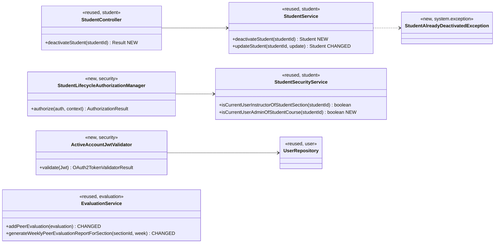
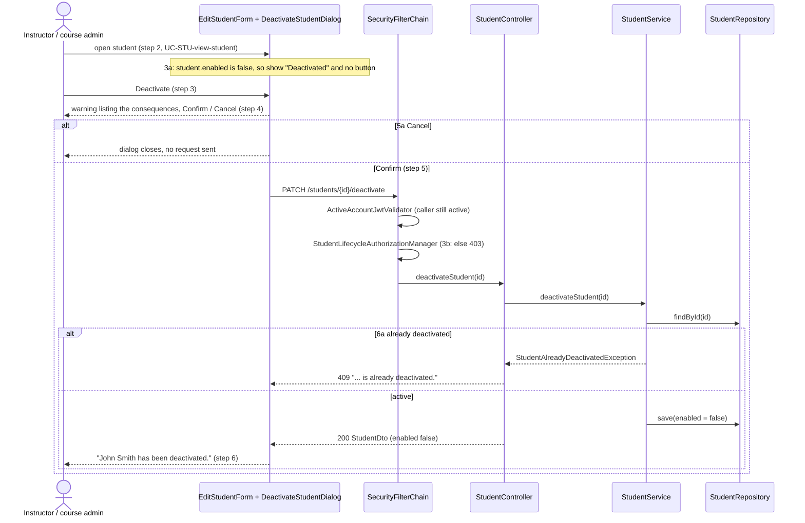

# Students (STU) Design

> Realizes: UC-STU-deactivate-student
> Depends on: FR-SEC-active-account, BR-student-lifecycle, BR-evaluatee-active, BR-submission-owed, BR-section-scoped-access, BR-role-based-access
> See: [use cases](../requirements/use-cases.md#student), [SRS security FRs](../requirements/software-requirements-specification.md#security-and-authorization-requirements), [architectural-design.md](architectural-design.md) (shared-foundation component view, Crosscutting Concepts: JWT and `AuthorizationManager`)
> Designed against `main` at `59f0267` (2026-11-05). The other STU use cases are design-as-built and not yet recorded here.

## Overview

Deactivation already exists as a side effect: `StudentService.updateStudent` copies the `enabled` flag from the edit form's switch when the caller is an instructor, with no warning, no check that she teaches the student's course section, and no effect on a student who is already logged in. This design gives deactivation its own endpoint and confirmation dialog, makes the "deactivated" meaning agree across the three code paths that read it, and makes every authenticated request re-check that the account is active (FR-SEC-active-account).

Three code paths disagreed before this design: `SubmissionStatusService.findOwedItems` skips a deactivated student, `EvaluationService.generateWeeklyPeerEvaluationReportForSection` lists her, and `EvaluationService.addPeerEvaluation` accepts an evaluation of her. BR-evaluatee-active settles it: she is skipped by all three.

## Components & classes



Files:
- Backend: `student/StudentController.java`, `student/StudentService.java`, `student/StudentSecurityService.java`, `security/SecurityConfiguration.java` (route rule, decoder), `security/ActiveAccountJwtValidator.java` (new), `security/authorizationmanagers/StudentLifecycleAuthorizationManager.java` (new), `system/exception/StudentAlreadyDeactivatedException.java` (new) and `ExceptionHandlerAdvice.java`, `evaluation/EvaluationService.java`.
- Frontend: `pages/students/EditStudentForm.vue` (the switch becomes a status tag and a Deactivate button), `pages/students/DeactivateStudentDialog.vue` (new), `apis/student/index.ts` (`deactivateStudent`), `pages/evaluations/SubmitTeamsEvaluations.vue` (lists only active teammates).

## Sequence

### UC-STU-deactivate-student: main success scenario



### FR-SEC-active-account: the deactivated student's next request

```mermaid
sequenceDiagram
    actor St as Deactivated student (still holds a token)
    participant D as JwtDecoder
    participant V as ActiveAccountJwtValidator
    participant U as UserRepository
    St->>D: any request, Bearer token
    D->>D: signature, expiry (JwtValidators default)
    D->>V: validate(jwt)
    V->>U: findById(jwt.userId)
    U-->>V: enabled = false
    V-->>D: failure "account is deactivated"
    D-->>St: 401 (InvalidBearerTokenException envelope); the frontend sends her to login
```

## API contract

| Endpoint | Caller (who may) | Request | Success | Errors, by extension |
|---|---|---|---|---|
| `PATCH /api/v1/students/{studentId}/deactivate` | An instructor assigned to the student's course section, or the course admin of its course (BR-student-lifecycle, BR-role-based-access): `StudentLifecycleAuthorizationManager`; rule added before the `denyAll()` catch-all | No body | `200`, message "Deactivate student successfully", data the `StudentDto` with `enabled: false` | 3b: any other instructor, a course admin of another course, or a student (herself included): `403` "No permission." 6a: already deactivated: `409` `CONFLICT`, "&lt;First Last&gt; is already deactivated." An unknown id is `403`, as the security services fail closed |
| `PUT /api/v1/students/{studentId}` (changed) | Unchanged | Unchanged | Unchanged, except that `enabled: false` is ignored: it can no longer deactivate | Unchanged |
| Every authenticated route (changed) | — | Bearer token of a deactivated student or instructor | — | `401` `UNAUTHORIZED`, "The access token provided is expired, revoked, malformed, or invalid for other reasons." (FR-SEC-active-account) |
| `POST /api/v1/evaluations` (changed) | Unchanged | Unchanged | Unchanged | Evaluatee deactivated: `400` `INVALID_ARGUMENT`, "&lt;First Last&gt;'s account is deactivated, so she cannot be evaluated." (BR-evaluatee-active) |
| `GET /api/v1/evaluations/sections/{sectionId}/week/{week}` (changed) | Unchanged | Unchanged | Deactivated students are omitted from `peerEvaluationAverages` (BR-evaluatee-active) | Unchanged |

## Key decisions

**A dedicated endpoint, not the edit form's switch.** Deactivation gets `PATCH /students/{id}/deactivate` with its own security rule, and `updateStudent` stops honouring `enabled: false`. Rejected: keeping the switch and adding a confirm dialog in front of `PUT /students/{id}`, because that route's rule (`UserOwnershipAuthorizationManager`) admits the student herself and does not admit a course admin who is not assigned to the section, so 3b could not be enforced on it. `updateStudent` keeps accepting `enabled: true` as the interim way back to active until UC-STU-reactivate-student is built (recorded in its Associated Information).

**Who may call it.** A new `StudentLifecycleAuthorizationManager` admits the student's section instructors (`isCurrentUserInstructorOfStudentSection`, reused) or her course's admin (`isCurrentUserAdminOfStudentCourse`, new). Rejected: `StudentInstructorAuthorizationManager` alone, which denies a course admin not assigned to the section, which BR-student-lifecycle and BR-role-based-access let in. Rejected: `UserOwnershipAuthorizationManager`, which lets a student deactivate herself.

**Re-check the account on every request, in the JWT decoder.** `ActiveAccountJwtValidator` is added to the `NimbusJwtDecoder`'s validators, so a token whose `userId` names a disabled account fails validation and the existing entry point answers `401`. It covers instructors too, which FR-SEC-active-account also requires. Rejected: waiting for the 2-hour token to expire, which breaks FR-SEC-active-account. Rejected: a token deny-list, which needs storage and still has to be consulted on every request. Rejected: a servlet filter after authentication, which duplicates the error handling the bearer-token entry point already does. Cost: one primary-key lookup per authenticated request; at course scale (under 100 users) that is negligible. This is shared code: it is committed first, on its own.

**409 for a repeat deactivation.** Rejected: silent success (idempotent `200`), which hides that the instructor's screen was stale (6a).

**Peer evaluations of a deactivated student.** `addPeerEvaluation` rejects an inactive evaluatee after the same-team check and before the duplicate check, as `400` like its other submission rules (BR-team-assignment-required says such refusals name the condition rather than being permission errors). The section report filters out students whose account is disabled. The submit page lists only active teammates, so a student is not offered an evaluation the server will refuse. Rejected: showing her on the section report flagged as deactivated (decided in Part 1).

**No change to team membership.** Per BR-student-lifecycle she stays on her team; nothing in `TeamService` changes.

## Data model

No delta. Deactivation is `PeerEvaluationUser.enabled = false`, the column that already exists (SRS [Business Domain Model](../requirements/software-requirements-specification.md#business-domain-model)). No deactivation timestamp is stored, so the section report omits her for every week, including weeks before her deactivation; her earlier evaluations remain in her own student report (BR-evaluatee-active).

## Reuse & cross-cutting

- Authorization: `StudentSecurityService` (extended), composed in a new manager like the other `security/authorizationmanagers`.
- Errors: the `Result` envelope via `ExceptionHandlerAdvice`; the new `StudentAlreadyDeactivatedException` maps to `409` like `SectionLockRequiredException`. Validator failures reuse the existing `InvalidBearerTokenException` handler.
- Reminders: unchanged; `SubmissionStatusService.findOwedItems` already skips disabled students (BR-submission-owed).
- Login: unchanged; `MyUserPrincipal.isEnabled()` already makes HTTP Basic login fail for a disabled account.

## Tests

| Use case, flow | Level | Asserts |
|---|---|---|
| Main success | integration | Bill (assigned instructor) `PATCH`es John: `200`, `enabled: false`; John's row is disabled |
| Main success, course admin | integration | Bingyang (course admin) deactivates a section-2 student: `200` |
| Main success | unit | `deactivateStudent` sets `enabled` false and saves |
| 3b, outside the section | integration | Tim (admin of another course) gets `403`; John stays enabled |
| 3b, the student herself | integration | John `PATCH`es himself: `403` |
| 6a, already deactivated | integration | A second `PATCH` returns `409` with the already-deactivated message |
| 6a | unit | `deactivateStudent` on a disabled student throws `StudentAlreadyDeactivatedException` and does not save |
| Generic edit can't deactivate | unit | `updateStudent` with `enabled: false` leaves an active student enabled |
| FR-SEC-active-account, logged in | integration | John's token from before the deactivation gets `401` on `GET /students/4` afterwards |
| FR-SEC-active-account, login | integration | After deactivation, John's HTTP Basic login fails with `401` |
| BR-evaluatee-active, submit | integration | With Eric deactivated, John's evaluation of Eric returns `400` with the deactivated message and nothing is saved |
| BR-evaluatee-active, report | integration | With Jerry deactivated, the section-2 report for 2023-W31 has 10 averages, none for Jerry |
| BR-submission-owed | existing | `SubmissionStatusServiceTest`: a deactivated student owes nothing (kept) |
| 3a, 5a, step 4 | manual (no frontend test harness for these pages) | Deactivated student shows a tag and no button; Cancel sends no request; the warning lists the consequences |

## Open questions / risks

- **No deactivation date.** The section report omits a deactivated student for past weeks too. Accepted, since her own report keeps her history; storing a timestamp would need a migration.
- **One extra query per request** from `ActiveAccountJwtValidator`. Accepted at course scale; cache per request or per minute if it shows up in profiling.
- **Reactivation** still goes through the generic edit until UC-STU-reactivate-student is built.
- **Frontend tests.** 3a and 5a are checked by hand; the student pages have no Cypress coverage.
